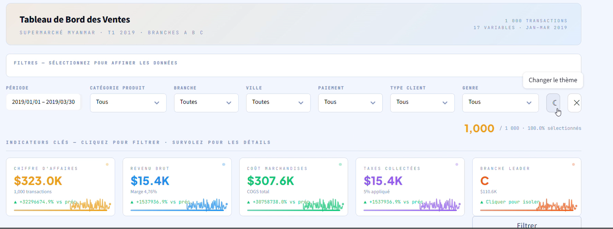

<div align="center">

# Sales Dashboard

### Les chiffres d'un supermarché racontent une histoire. Ce tableau de bord vous la lit.


*Un tableau de bord interactif pour explorer les performances commerciales,<br>repérer les tendances et décider avec des données plutôt qu'au feeling.*

<br>



</div>

---

## Sommaire

- [Le point de départ](#le-point-de-départ)
- [Ce que vous pouvez faire](#ce-que-vous-pouvez-faire)
- [Une galerie de 9 visualisations](#une-galerie-de-9-visualisations)
- [Les données](#les-données)
- [Démarrage rapide](#démarrage-rapide)
- [Structure du projet](#structure-du-projet)
- [Principaux enseignements](#principaux-enseignements)
- [Technologies](#technologies)
- [Pistes d'amélioration](#pistes-damélioration)
- [Licence](#licence)
- [Auteure](#auteure)

---

## Le point de départ

Imaginez que vous dirigez un supermarché présent dans plusieurs villes. Vous avez des milliers de tickets de caisse, mais aucune réponse claire. Ce projet, réalisé dans le cadre d'un cours de **visualisation de données**, transforme ces tickets en cinq réponses concrètes :

| La question | Ce que le dashboard montre |
|---|---|
| **Où gagne-t-on de l'argent ?** | Les villes et les gammes de produits qui génèrent le plus de chiffre d'affaires |
| **Quand vend-on ?** | L'évolution des ventes dans le temps |
| **Qui achète ?** | Le profil des clients : genre, type de client, mode de paiement |
| **Les clients sont-ils contents ?** | Le niveau de satisfaction et ses variations |
| **Qu'est-ce qui influence quoi ?** | Les relations entre prix, quantité, marge et note |

---

## Ce que vous pouvez faire

### Filtrer, et tout bouge

La barre latérale est votre télécommande. Choisissez ce qui vous intéresse :

`Ville` · `Gamme de produits` · `Mode de paiement` · `Genre` · `Note` · `Mois`

Chaque filtre met à jour **tous** les indicateurs et **tous** les graphiques en temps réel.

### Les quatre chiffres à garder en tête

| KPI | Ce qu'il mesure |
|---|---|
| **Ventes totales** | La somme du chiffre d'affaires |
| **Transactions** | Le nombre de ventes |
| **Note moyenne** | La satisfaction client (sur 10) |
| **Panier moyen** | Le montant moyen par transaction |

---

## Une galerie de 9 visualisations

| Graphique | À quoi il sert |
|---|---|
| **Diagramme en barres** | Comparer les ventes par gamme de produits ou par ville |
| **Diagramme circulaire** | Voir la répartition des modes de paiement |
| **Courbe temporelle** | Suivre l'évolution des ventes dans le temps |
| **Histogramme** | Comprendre la distribution des montants de vente |
| **Boxplot** | Mesurer la dispersion par catégorie et repérer les valeurs atypiques |
| **Scatter plot** | Explorer la relation entre prix unitaire, quantité et montant |
| **Heatmap** | Révéler les corrélations entre variables numériques |
| **Sunburst** | Plonger dans la hiérarchie ville, gamme, paiement |
| **Gauge** | Lire d'un coup d'oeil le niveau global de satisfaction |

---

## Les données

Le dataset contient les transactions d'un supermarché réparties sur plusieurs villes. Source : [Supermarket Sales, Kaggle](https://www.kaggle.com/datasets/aungpyaeap/supermarket-sales).

<details>
<summary><b>Voir le dictionnaire des colonnes</b></summary>

<br>

| Colonne | Description |
|---|---|
| `Invoice ID` | Identifiant de la facture |
| `Branch` / `City` | Succursale / ville |
| `Customer type` | Membre ou non-membre |
| `Gender` | Genre du client |
| `Product line` | Gamme de produits |
| `Unit price` / `Quantity` | Prix unitaire / quantité |
| `Tax 5%` / `Total` | Taxe / montant total |
| `Date` / `Time` | Date et heure de la vente |
| `Payment` | Mode de paiement |
| `Rating` | Note de satisfaction (1 à 10) |

</details>

> Les données appartiennent à leur auteur d'origine et suivent les conditions indiquées sur Kaggle. La licence MIT de ce dépôt couvre le code du projet.

---

## Démarrage rapide

Quatre commandes, et le dashboard tourne chez vous.

```bash
# 1. Cloner le dépôt
git clone https://github.com/Chaymae-El-Bahloul/<nom-du-repo>.git
cd <nom-du-repo>

# 2. (Optionnel) Créer un environnement virtuel
python -m venv venv
source venv/bin/activate        # Windows : venv\Scripts\activate

# 3. Installer les dépendances
pip install -r requirements.txt

# 4. Lancer l'application
streamlit run app.py
```

L'application s'ouvre sur **http://localhost:8501**.

---

## Structure du projet

```
.
├── app.py                    # Application Streamlit principale
├── data/
│   └── supermarket_sales.csv # Le jeu de données
├── assets/                   # Captures d'écran
├── requirements.txt          # Dépendances Python
├── LICENSE                   # Licence MIT
└── README.md
```

---

## Principaux enseignements

> *À compléter avec vos propres résultats : c'est la partie qui donne tout son sens au projet.*

- La gamme **X** représente **Y %** du chiffre d'affaires.
- Les ventes sont plus élevées en **[mois / jour / heure]**.
- La note moyenne est de **X/10**, avec peu de variation selon la ville.
- Les corrélations montrent que **[observation]**.

---

## Technologies

| Outil | Rôle |
|---|---|
| **Python** | Langage principal |
| **Streamlit** | Interface web interactive |
| **Pandas** | Nettoyage et manipulation des données |
| **Plotly** | Graphiques interactifs |

---

## Pistes d'amélioration

- [ ] Export des données filtrées (CSV / Excel)
- [ ] Comparaison de périodes (mois vs mois précédent)
- [ ] Prévision des ventes (Prophet, ARIMA)
- [ ] Mode sombre / clair
- [ ] Déploiement sur Streamlit Community Cloud

Une idée en plus ? Ouvrez une *issue* ou proposez une *pull request*.

---

## Licence

Ce projet est distribué sous licence **MIT** : vous pouvez l'utiliser, le modifier et le redistribuer librement, à condition de conserver la mention de copyright. Voir le fichier [LICENSE](LICENSE) pour le texte complet.

---

<div align="center">

## Auteure

**Chaymae El Bahloul**

[](https://www.linkedin.com/in/chaymae-el-bahloul)
[](https://github.com/Chaymae-El-Bahloul)

*Si ce projet vous a plu, laissez une étoile sur le dépôt.*

</div>
